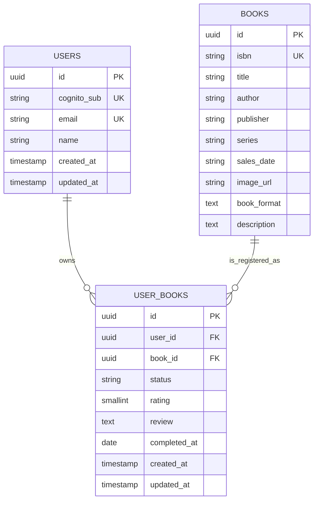

# ER図

## 全体



## テーブルの関係

- USERS と BOOKS は直接つながらず、USER_BOOKS を介した多対多の関係
- 同じ書籍カタログ情報は BOOKS に一度だけ保存する
- ユーザーごとの読書状況・評価・レビューは USER_BOOKS に保存する
- USER_BOOKS には (user_id, book_id) の一意制約があり、同じユーザーが同じ本を重複登録できない

## 認証

ユーザー認証は AWS Cognito を使用する。

- Cognito の sub は USERS.id ではなく、USERS.cognito_sub に保存する

```text
Google
  ↓
AWS Cognito
  ↓
Cognito sub
  ↓
USERS.cognito_sub
  ↓
USERS.id（アプリ内のUUID）
  ↓
USER_BOOKS.user_id
```
